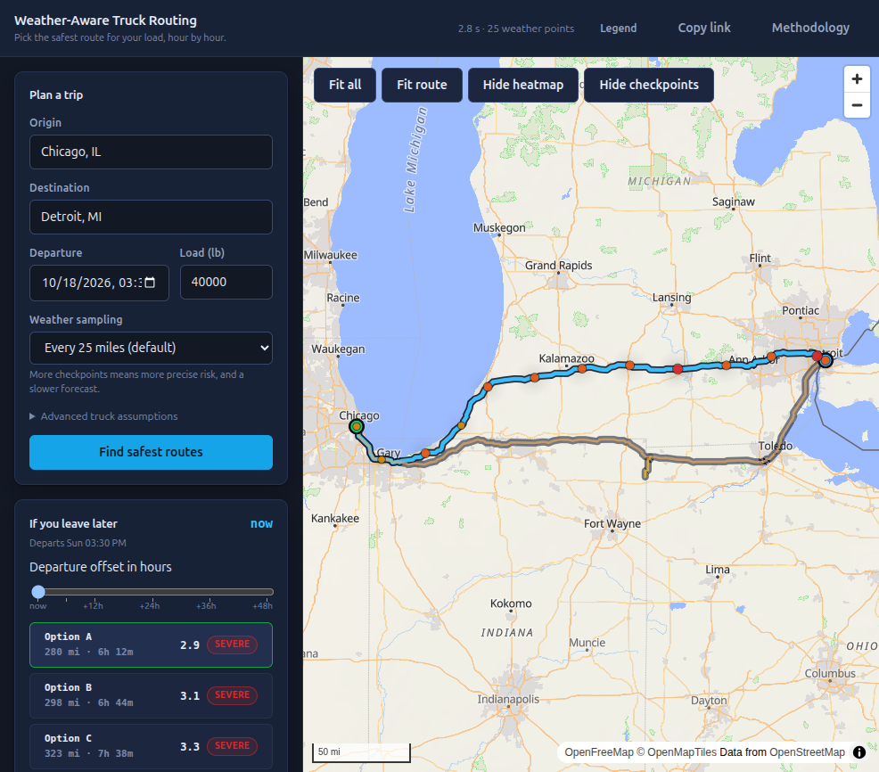

# Weather-Aware Truck Routing

Three routes, compared by **road miles at each risk level** — not by average
weather, and not by shortest time. Pick an origin, a destination, a load weight
and a departure time; the app ranks the corridors worst-first and lets you drag
the departure forward 48 hours to see how the answer changes.



---

## Run it

```bash
docker compose up --build     # → http://localhost:5173
```

That is the whole thing: backend (Django + gunicorn), frontend (nginx serving the
built bundle), and Redis. No API keys — every upstream used here is keyless and
free, with attribution.

Without Docker:

```bash
make install      # backend venv + npm install
make dev          # Django on :8000, Vite on :5173 (proxies /api)
```

Set `WEATHER_PROVIDER=mock` for a deterministic synthetic storm — useful when
the network is unavailable or when you want the same answer twice.

---

## Why it is built this way

Four decisions shaped everything else. Each is recorded with its reasoning in
[`docs/DECISIONS.md`](docs/DECISIONS.md); the short version:

**Compare in miles, not averages.** "Option C is 0.01 lower average risk" is
noise, and letting it decide a *safety* recommendation is worse than not ranking
at all. Routes are ranked lexicographically on no-travel miles, then severe, then
high, then average risk (compared at one decimal, so rounding cannot decide it),
then travel time. Miles are attributed to checkpoints by **midpoint boundaries**,
which partitions the route exactly — so a 10-mile and a 50-mile sampling are
compared fairly.

**The slider must be free.** Leaving later changes what the truck meets, so the
level at departure offset *h* is `hourly_risk[eta_hour_index + h]` — an array
lookup. Dragging 0 → 48 h issues **zero** network requests and re-renders the map
component **zero** times; the map repaints via `setData`. Both numbers are
asserted by a test that fails if the prop threading is reintroduced.

**Stream the geometry first.** A real analysis takes ~21 s, almost all of it
waiting on weather. The map is usable after ~2.5 s because `/analyze/stream/`
sends geometry and summaries first and the checkpoint risk behind them. nginx is
configured with `proxy_buffering off` specifically so this survives the proxy.

**No risk logic in the browser.** Thresholds, level colours, the load policy and
the ranking order all come from `GET /api/v1/config/`. The frontend holds no
number it could disagree with, and a parity test feeds a backend-generated
fixture through the frontend selectors at 0/6/24/48 h to prove it.

---

## Architecture

```
browser ──► nginx ──┬──► index.html + hashed assets   (SPA fallback)
                    └──► /api ──► gunicorn ──► Django ──► adapters
                                                          │
                                        Open-Meteo (geo + hourly weather)
                                        OSRM (routing) · OpenFreeMap (tiles)
```

The domain (`tripplan/domain/`) is pure Python with no Django import, enforced
by a test. Adapters sit behind protocols, so the mock weather provider and the
real one are interchangeable — which is what makes the whole suite runnable with
no network.

For deployment and component diagrams, event flow, cache behavior, and browser
state boundaries, see [the detailed architecture](docs/ARCHITECTURE.md).

| Path | What lives there |
|---|---|
| `backend/tripplan/domain/` | risk rules, mileage, recommendation, geometry, ETA — pure, no I/O |
| `backend/tripplan/adapters/` | geocoding, routing, weather; each behind a protocol |
| `backend/tripplan/services/` | orchestration; yields the same events both endpoints consume |
| `backend/tripplan/api/` | validation, error taxonomy, NDJSON streaming, `/config/` |
| `frontend/src/lib/` | selectors, map data, streaming client, URL state — pure and testable |
| `frontend/src/store/` | Zustand store; stream events folded into UI state |
| `frontend/src/components/` | form, map, panels, slider, modal |

### API

| Endpoint | Purpose |
|---|---|
| `POST /api/v1/trips/analyze/stream/` | NDJSON. **Use this one.** |
| `POST /api/v1/trips/analyze/` | The same payload in one JSON body, for curl and CI |
| `GET /api/v1/config/` | Thresholds, colours, load policy, assumptions |
| `GET /api/v1/health/` | Liveness |

```bash
curl -X POST http://localhost:5173/api/v1/trips/analyze/stream/ \
  -H 'Content-Type: application/json' -H 'Accept: application/x-ndjson' \
  -d '{"origin":"Chicago, IL","destination":"Detroit, MI",
       "departure":"2026-10-18T14:00:00Z","load_lb":40000,"spacing_mi":25}'
```

Events arrive in contract order: `meta`, `route`×3, `weather_plan`, `weather`,
`checkpoints`+`summary` per route, `recommendation`, `done` — or a terminal
`error` event if a failure occurs after the stream opens.

---

## Development

```bash
make test          # 433 backend + 48 frontend tests, no network
make lint          # ruff + format, oxlint + tsc, and the contract drift check
make security      # secret scan
make gen-types     # regenerate frontend/src/types/contract.json
```

Everything the frontend asserts about the backend is checked in CI: a rename on
the server fails the contract job even though the hand-written types still
compile.

### Documentation

| File | What it holds |
|---|---|
| [`docs/ARCHITECTURE.md`](docs/ARCHITECTURE.md) | Deployment, backend, request-sequence, and browser-state diagrams |
| [`docs/DEPLOY-RENDER.md`](docs/DEPLOY-RENDER.md) | Free Render Blueprint setup and deployment checks |
| [`docs/DECISIONS.md`](docs/DECISIONS.md) | Why each non-obvious choice was made |
| [`docs/BUGS.md`](docs/BUGS.md) | **59 defects found during implementation**, with root cause and the guard that now prevents each |
| [`docs/BENCHMARKS.md`](docs/BENCHMARKS.md) | Measured latencies and bundle sizes — including what was *not* measured |
| [`docs/QA-CHECKLIST.md`](docs/QA-CHECKLIST.md) | Browser QA results and what remains unverified |
| [`docs/TASKS.md`](docs/TASKS.md) | The build plan and its current state |

---

## Assumptions and limitations

These are stated in the app's Methodology panel too, because someone relying on
this to make a real decision needs to know them.

- **Forecasts are hourly.** Sampling checkpoints every 10 miles refines *where*
  risk is measured, not how well the weather is known. A reading can be up to an
  hour from the moment it describes.
- **Snow is reported as depth, rain as liquid equivalent** — roughly 7:1. They are
  different quantities and are never summed.
- **Precipitation values are preceding-hour sums**, per Open-Meteo.
- **Truck speed is an assumption**: routing returns car times, scaled by 0.85 and
  clamped to 25–65 mph. Adjustable in the form, and the value is displayed.
- **Three routes is a floor, not a guarantee of quality.** When a routing service
  offers fewer alternatives, the third is synthesised from via-waypoints and
  labelled `generated` in the UI.
- **This is not an official weather alert**, and it does not know about road
  closures. Treat No Travel as a hard stop and check conditions before leaving.

## Data sources

Routing and geocoding by [OSRM](https://project-osrm.org/) and
[Open-Meteo](https://open-meteo.com/); hourly forecasts by Open-Meteo; base map
tiles by [OpenFreeMap](https://openfreemap.org/). All keyless and free to use,
with attribution rendered on the map.

## Licence

MIT — see [LICENSE](LICENSE).
