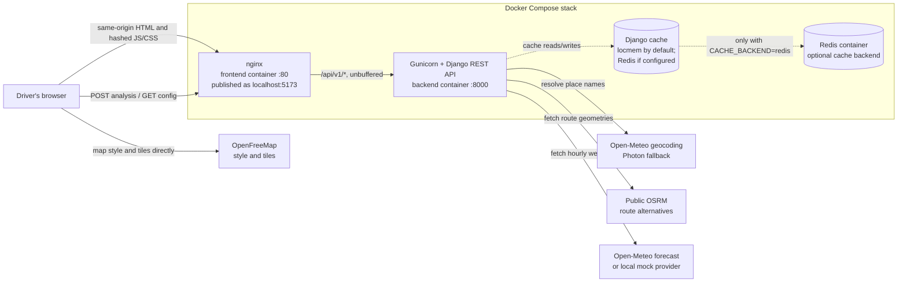
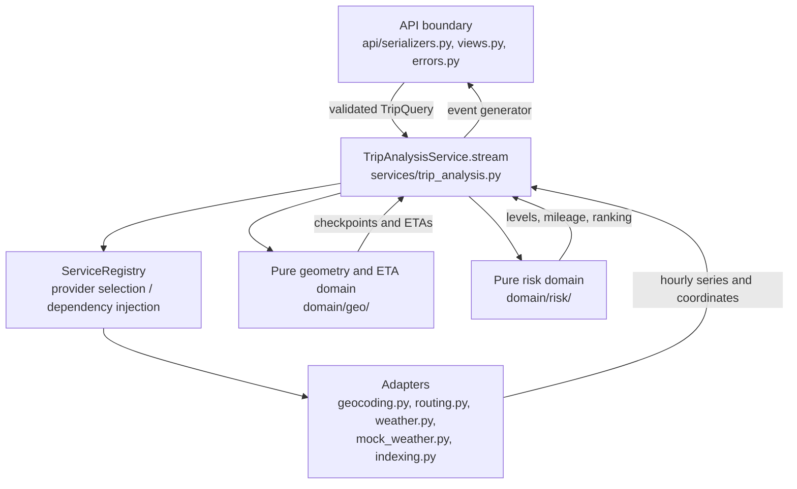
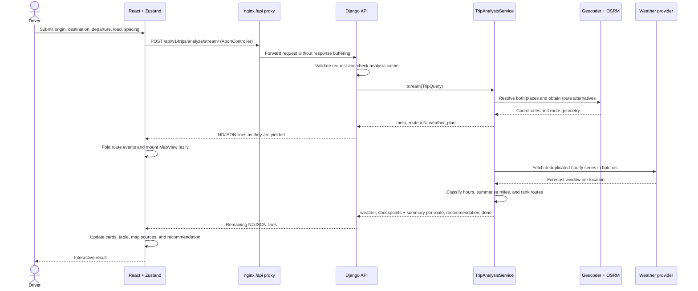
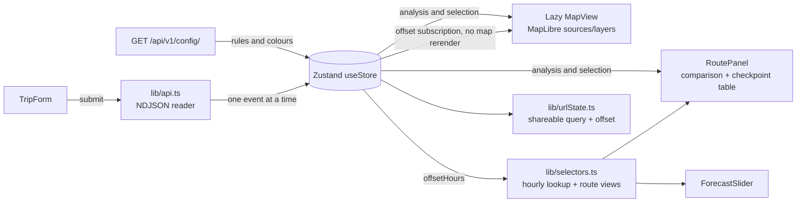

# Architecture

This document describes the implemented system. Start with the deployment view,
then follow one analysis request through the backend and back into the UI.

## Deployment and component boundaries

- `docker-compose.yml` starts the three containers. Only nginx publishes a host
  port. The backend is reached over the internal Compose network; Redis is
  present but **not used by default** (`CACHE_BACKEND=locmem`). Set the cache
  backend to Redis when multiple Gunicorn workers should share cached results.
- `frontend/docker/nginx.conf` serves the built SPA and proxies `/api/` to Django.
  It disables response buffering so NDJSON arrives incrementally, and gives
  hashed assets long-lived caching while keeping `index.html` fresh.
- The browser fetches OpenFreeMap independently of Django. Map tiles do not
  pass through the API or Redis. In local development, Vite proxies `/api` to
  Django instead of nginx (`frontend/vite.config.ts`).
- Compose defaults to **mock weather**; `WEATHER_PROVIDER=open_meteo` switches to
  real forecasts. Geocoding and routing still use external, keyless providers.
  The mock is also used in offline tests. The production settings module is
  `backend/config/settings/prod.py`; a real deployment must supply its own
  secret, hosts, and TLS termination configuration.

## Backend layers

1. `api/serializers.py` validates the request before a streaming HTTP response
   begins. `api/views.py` translates provider errors into public error codes.
2. `ServiceRegistry.from_settings()` injects the geocoder chain (Open-Meteo,
   then Photon), OSRM router, selected weather provider, and policy settings.
   `adapters/http.py` owns provider HTTP calls. The domain has no Django import
   or network I/O.
3. `domain/geo/` samples route geometry at the requested spacing and computes
   truck-adjusted checkpoint ETAs. `adapters/weather.py` plans the forecast
   window and deduplicates/coarsens weather locations to a configured budget.
   Forecast requests are batched sequentially rather than fanned out.
4. `adapters/indexing.py` evaluates each checkpoint for every forecast hour via
   `domain/risk/`. The base-hour assessment has detailed readings and reasons;
   `hourly_risk` contains the level ordinals for later departure choices.
   `domain/risk/miles.py` attributes distance by checkpoint midpoints, and
   `domain/risk/recommend.py` ranks routes lexicographically: fewer No Travel,
   Severe, and High miles, then average risk, drive time, and distance.
5. `TripAnalysisService.stream()` yields events. The JSON endpoint drains the
   same generator through `analyze()`, rather than implementing a second
   calculation path.

## A streaming analysis, in order

The successful event sequence is `meta`, one or more `route` events,
`weather_plan`, `weather`, then `checkpoints` and `summary` for each route,
`recommendation`, and `done`. Geometry can display before the slower forecast
finishes. Invalid input receives a normal JSON 400 **before** the stream opens;
failure after it opens is a terminal NDJSON `error` event (the status can no
longer change). The client rejects a stream that ends without `done` or `error`.

`POST /api/v1/trips/analyze/` returns the full result as JSON. Its successful
responses populate the analysis cache (default TTL from settings); the stream
endpoint can replay that cached payload but does not itself populate the cache.
`GET /api/v1/config/` exposes the server's thresholds, levels, colours, ranking
and assumptions. `GET /api/v1/health/` is a liveness endpoint that does not call
upstream providers. See `backend/tripplan/api/urls.py` for routes.

## Browser state and rendering

- `frontend/src/App.tsx` loads configuration, restores shared-link inputs,
  submits and aborts streams, and mounts `MapView` only after route geometry
  exists. `frontend/src/store/useStore.ts` folds events into one analysis and
  stores selection, hover, layer toggles, and the departure offset. This is a
  direct stream reader, **not** a TanStack Query request.
- The departure slider reads the backend-precomputed
  `hourly_risk[eta_hour_index + offsetHours]`. Changing it makes **no** weather
  request and does not reclassify risk in JavaScript. Selectors recalculate
  route summaries from the shifted levels; MapLibre sources and the optional
  risk strip repaint through a store subscription without remounting the map.
- `frontend/src/components/MapView.tsx` draws route lines, endpoints,
  checkpoints, corridor heatmap, and an opt-in graduated risk strip. Style and
  tile loading is asynchronous; interactions and layer visibility attach after
  the MapLibre `load` event. Table hover and map hover share checkpoint IDs.
- URLs contain inputs and offset, not the large analysis payload. Opening a
  link restores the form and departure choice; a new analysis still requires
  submission. The backend-generated contract fixture in
  `frontend/src/types/contract.json` is checked for drift in CI.

## Important boundaries and limitations

The server is the sole authority for thresholds, risk classification, and
ranking. The browser receives only a base-hour detailed reading and per-hour
level ordinals: shifting the slider changes levels and ETAs, but it cannot
reconstruct detailed wind/rain/snow readings or reasons for another hour.
Weather is hourly even when checkpoints are sampled every 10 miles. Provider
failures during weather fetch degrade to a warning and unavailable risk data;
they must not be interpreted as a safe forecast. For measured performance and
remaining browser verification, see [BENCHMARKS.md](BENCHMARKS.md) and
[QA-CHECKLIST.md](QA-CHECKLIST.md).
